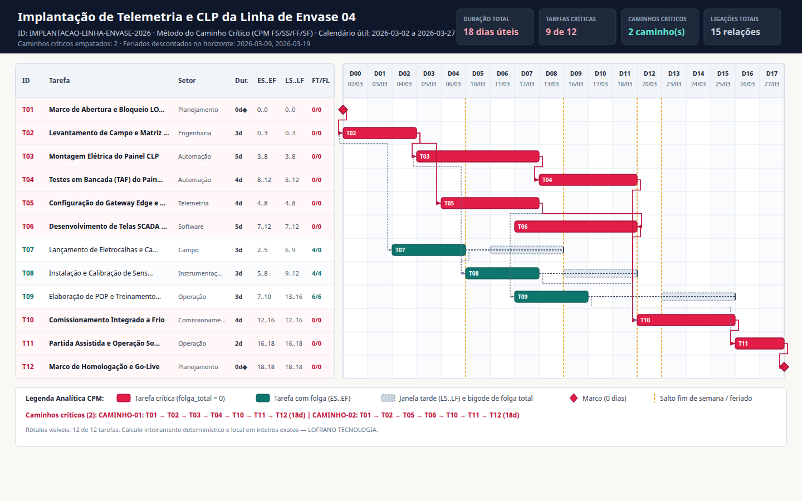

# Cronograma Crítico

Planeje projetos pelo **Método do Caminho Crítico (CPM)** com relações de precedência generalizadas (`FS`, `SS`, `FF` e `SF`), defasagens inteiras positivas ou negativas, calendário explícito de dias úteis e feriados, cálculo de folga total e folga livre, detecção determinística de ciclos com caminho testemunha e enumeração completa de **todos os caminhos críticos empatados**.

CLI e biblioteca Python da [LOFRANO TECNOLOGIA](https://lofranotecnologia.com.br/), em português, sob [licença MIT](LICENSE). Todo o cálculo usa exclusivamente aritmética inteira exata (`int`) e `datetime.date` da biblioteca padrão — sem arredondamentos de ponto flutuante, servidor, rede, conta ou dependências externas em tempo de execução.



## Experimentar

Requer Python 3.11 ou posterior. Crie um ambiente virtual e instale o pacote a partir da fonte:

```sh
git clone https://github.com/martinlofranodeoliveira/cronograma-critico.git
cd cronograma-critico
python -m venv .venv
```

No Linux/macOS:

```sh
.venv/bin/python -m pip install .
.venv/bin/cronograma-critico exemplo --saida exemplo-cronograma.zip
```

No Windows:

```powershell
.venv\Scripts\python -m pip install .
.venv\Scripts\cronograma-critico exemplo --saida exemplo-cronograma.zip
```

A [versão 1.0.0](https://github.com/martinlofranodeoliveira/cronograma-critico/releases/tag/v1.0.0) também disponibiliza wheel, distribuição-fonte (`sdist`), pacote ZIP do exemplo e somas SHA-256.

Extraia `exemplo-cronograma.zip` e abra `gantt-cpm.svg`, `RELATORIO.md` e `LEIA-ME.md`. O cenário sintético autoral (*Implantação de Telemetria e CLP da Linha de Envase 04*) possui 12 tarefas, 2 marcos de duração zero, 15 ligações (`FS`, `SS` e `FF` com defasagens de `-1` a `+4` dias), 2 feriados descontados (`2026-03-09` e `2026-03-19`), duração total de **18 dias úteis** (`2026-03-02` a `2026-03-27`) e **2 caminhos críticos empatados** enumerados integralmente.

## Planejar seu cronograma

```sh
cronograma-critico planejar entrada.json --saida resultado.zip
```

O arquivo `entrada.json` declara o cabeçalho do projeto (`id`, `titulo`, `data_inicio`), o calendário de trabalho (`dias_uteis_semana` no padrão ISO `1..7` e lista de `feriados`), a lista de `tarefas` (`id`, `nome`, `duracao_dias`, `setor`) e a lista de `dependencias` (`id`, `origem`, `destino`, `tipo`, `defasagem_dias`). A especificação completa encontra-se em [FORMATO.md](docs/FORMATO.md) e a interface programática em [API.md](docs/API.md).

O pacote `.zip` gerado contém oito arquivos determinísticos:

| Arquivo | Conteúdo |
| --- | --- |
| `entrada.json` | Bytes exatos do documento JSON de entrada |
| `cronograma.json` | Memória de cálculo estruturada (`ES`, `EF`, `LS`, `LF`, `folga_total`, `folga_livre`, `folga_ligacao`, datas civis e todos os caminhos críticos) |
| `tarefas.csv` | Quadro tabular de tarefas com proteção contra injeção de fórmulas em planilhas |
| `caminhos-criticos.csv` | Todos os caminhos críticos empatados em ordem lexicográfica ASCII |
| `RELATORIO.md` | Relatório de auditoria em português com tabelas de tarefas, ligações e calendário |
| `gantt-cpm.svg` | Gráfico de Gantt vetorial com barras cedo/tarde, bigodes de folga, marcos em losango e setas de precedência |
| `LEIA-ME.md` | Guia rápido de leitura e interpretação do pacote |
| `SHA256SUMS` | Somas SHA-256 dos demais sete arquivos (`sha256sum -c SHA256SUMS`) |

Um arquivo ou link simbólico já existente no caminho `--saida` nunca é sobrescrito: a publicação grava um arquivo temporário irmão no mesmo diretório e cria o destino por `os.link` atômico.

## Modelo matemático das relações `FS`, `SS`, `FF` e `SF`

Para cada tarefa $u$ com duração inteira $D(u) \ge 0$, valem $EF(u) = ES(u) + D(u)$ e $LF(u) = LS(u) + D(u)$. Cada ligação $e = (u \to v)$ com tipo $\tau \in \{\text{FS}, \text{SS}, \text{FF}, \text{SF}\}$ e defasagem inteira $L \in [-365, 365]$ impõe a restrição linear $ES(v) - ES(u) \ge \Delta(e)$:

| Tipo | Significado operacional | Inequação de domínio | Deslocamento $\Delta(e)$ |
| --- | --- | --- | --- |
| `FS` | Término-Início (*Finish-to-Start*) | $ES(v) \ge EF(u) + L$ | $D(u) + L$ |
| `SS` | Início-Início (*Start-to-Start*) | $ES(v) \ge ES(u) + L$ | $L$ |
| `FF` | Término-Término (*Finish-to-Finish*) | $EF(v) \ge EF(u) + L$ | $D(u) + L - D(v)$ |
| `SF` | Início-Término (*Start-to-Finish*) | $EF(v) \ge ES(u) + L$ | $L - D(v)$ |

- **Recusa de ciclos (`CICLO_DETECTADO`)**: a rede é verificada por ordenação topológica de Kahn; se houver auto-laço ou ciclo dirigido, o motor recusa a entrada e informa o caminho testemunha fechado canônico (`[t1, t2, ..., t1]`).
- **Recusa de início negativo (`DATA_ANTERIOR_AO_INICIO`)**: se uma defasagem negativa produzir $ES(u) + \Delta(e) < 0$ (antes do índice `0` de início do projeto), a ligação causadora é identificada e recusada explicitamente.
- **Folgas e todos os caminhos críticos**: `folga_total(u) = LS(u) - ES(u)` e `folga_livre(u)` mede o atraso máximo de $u$ sem atrasar o início cedo de nenhum sucessor imediato (`folga_ligacao(e) = ES(v) - (ES(u) + \Delta(e))`). Nenhum caminho crítico empatado é omitido silenciosamente; o limite de enumeração padrão é `1000` caminhos (configurável de `1` a `10000` via `orcamento_caminhos` ou `--orcamento-caminhos`).

## Desenvolver e conferir

```sh
python -m pip install . -r requirements-build.txt
python -m unittest discover -s tests -v
python -m build
python scripts/check_distribution.py --dist dist
python tools/verify_independent.py --cli "$(command -v cronograma-critico)"
```

O verificador independente (`tools/verify_independent.py`) não importa `cronograma_critico`: resolve o sistema de inequações via relaxamento iterativo de Bellman-Ford, reconstrói o calendário civil com `datetime.date` e confere `SHA256SUMS`, CSVs e o DOM do SVG. Consulte [VERIFICACAO.md](docs/VERIFICACAO.md) e [INTEROPERABILIDADE.md](docs/INTEROPERABILIDADE.md) para detalhes.
